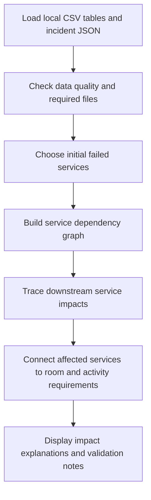

ClassRipple AI 🌊
Ripple Crisis Hackathon | THE RIPPLE: Campus in Crisis
ClassRipple AI is a Streamlit-based hackathon MVP for exploring how a campus incident can ripple through interconnected services and affect scheduled academic activities.

The project loads the supplied campus-crisis dataset, traces service dependencies, explains downstream impact paths, and identifies activities that may be affected by selected service failures.
Project status: Working MVP for explainable incident-impact analysis. It is not yet a complete timetable-recovery optimizer and does not certify that a proposed recovery schedule or engineering allocation is feasible.

✨ Key Features
- Campus incident overview — summarizes the loaded activities, rooms, services, and dataset tables.
- Ripple Explorer — select initial failed services and trace downstream dependencies up to a configurable depth.
- Visual dependency map — displays the ripple chain and groups potential impacts by dependency level.
- Activity Impact Analysis — checks whether selected unavailable or degraded services are required by rooms or activities, while considering incident time.
- Data Audit — reports table sizes, missing cells, duplicate rows, missing files, and dataset warnings.
- Transparent validation — shows service-ID checks and explains the limits of the current analysis.
- Offline dataset support — works with the project’s local CSV and JSON scenario files.
🧰 Tech Stack
Area	Technology
User interface	Streamlit
Data processing	Python, Pandas
Visualizations	Plotly
Dependency analysis	Graph traversal
Testing	Pytest
Input data	CSV and JSON

🖥️ Application Sections
1. Overview — campus situation, incident details, and dataset summary.
2. Ripple Explorer — service dependency graph, downstream impact table, and impact-level chart.
3. Activity Impacts — potentially affected activities, affected services, and explanations.
4. Data Audit — data-quality summary and validation notes.
5. How It Works — the analysis pipeline and next implementation milestones.
🗂️ Project Structure
ClassRippleAI_Fresh/
├── app.py
├── requirements.txt
├── README.md
├── .gitignore
├── data/
│   ├── activities.csv
│   ├── activity_modes.csv
│   ├── buildings.csv
│   ├── constraints.csv
│   ├── dependencies.csv
│   ├── incident.json
│   ├── room_services.csv
│   ├── rooms.csv
│   ├── service_links.csv
│   ├── services.csv
│   └── ... other scenario data and documentation
├── src/
│   ├── __init__.py
│   ├── activity_impact.py
│   ├── data_loader.py
│   ├── impact_engine.py
│   └── validation.py
└── tests/
    ├── test_activity_impact.py
    └── test_core.py
⚙️ Run Locally (Windows)
1. Clone the repository
git clone https://github.com/esnakaridharanioffical-lgtm/ClassRipple-AI-Hackathon-.git
cd ClassRipple-AI-Hackathon-
2. Create and activate a virtual environment
python -m venv .venv
.\.venv\Scripts\Activate.ps1
If PowerShell blocks activation, you can install and run using python without activating the environment.
3. Install dependencies
python -m pip install -r requirements.txt
4. Start the application
python -m streamlit run app.py
Streamlit will display a local URL (usually http://localhost:8501) in the terminal. Open it in your browser.
🧪 Run Tests
From the project root:
python -m pytest -q
The tests cover dependency traversal across downstream levels, cycle handling, service-link column mapping, incident service-ID extraction, and time-aware activity-impact matching.
🔍 How the Analysis Works

The dependency graph follows the service relationships supplied in data/service_links.csv. Activity-impact analysis uses activity schedules, room-service mappings, service states, and the selected incident time to identify potential impacts.
⚠️ Current Scope and Limitations
This hackathon MVP focuses on impact discovery and explainability. It does not yet:
- generate and certify a complete conflict-free recovery timetable;
- optimize alternate room and staff assignments;
- schedule engineering repairs with all prerequisite, parts, and personnel constraints;
- compare and validate multiple complete mitigation strategies;
- guarantee that every downstream dependency represents an actual outage.
Potential impacts should be reviewed against the scenario data and operating constraints before making real scheduling decisions.
🚀 Future Improvements
- Add a constraint-based timetable recovery engine.
- Include room, staff, timing, and activity-mode constraints in mitigation.
- Model repair jobs, prerequisites, personnel, and parts availability.
- Compare multiple recovery strategies with transparent trade-offs.
- Add exportable incident and recovery reports.
- Expand automated tests for edge cases and scenario validation.
👥 Hackathon Project
Project: ClassRipple AI
Challenge: THE RIPPLE — Campus in Crisis
Event: Ripple Crisis Hackathon

Built as a hackathon MVP to demonstrate explainable campus-incident impact analysis.
